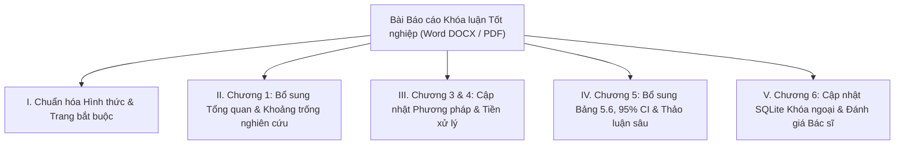

# 📋 KẾ HOẠCH HÀNH ĐỘNG CHI TIẾT THEO NHẬN XÉT PHẢN BIỆN KHÓA LUẬN TỐT NGHIỆP
> **Đề tài:** Nghiên cứu phương pháp ensemble cố định giữa CNN và Vision Transformer trong nhận diện viêm phổi từ ảnh X-quang ngực  
> **Mã đề tài:** CNTT-KLCN171  
> **Sinh viên thực hiện:** Nguyễn Gia Khang (NT), Phan Minh Tâm, Trịnh Minh Hiếu  
> **Giảng viên hướng dẫn:** TS. Phùng Thế Bảo  

---

## 📌 PHẦN 1: TỔNG HỢP CÁC LỖI VỀ CODE ĐÃ ĐƯỢC KHẮC PHỤC TRIỆT ĐỂ

Hệ thống mã nguồn đã được cập nhật, cấu trúc lại và kiểm thử toàn diện trên toàn bộ đường ống thực nghiệm (Data Pipeline $\rightarrow$ Modeling $\rightarrow$ Evaluation $\rightarrow$ Explainability $\rightarrow$ Web App & SQLite Database):

| STT | Vấn đề phản biện nêu | Lỗi trong mã nguồn cũ | Giải pháp kỹ thuật đã triển khai & Tệp code đã sửa |
| :--- | :--- | :--- | :--- |
| **1** | **Data Augmentation: Đổi vị trí bóng tim** | `src/data/dataset.py` dòng 28 sử dụng `RandomHorizontalFlip()`. Ảnh X-quang ngực có tính bất đối xứng giải phẫu học (tim nằm bên trái). Lật ngang làm tim bị đảo sang phải (dextrocardia), làm hỏng đặc trưng y khoa. | **Đã loại bỏ hoàn toàn** `RandomHorizontalFlip()`. Thay thế bằng các augmentation an toàn y tế: `RandomRotation(7)`, `RandomAffine(translate=(0.02, 0.02), scale=(0.98, 1.02))` và `ColorJitter`. 📁 *File: `src/data/dataset.py`* |
| **2** | **Tập Validation 16 ảnh & Nguy cơ Rò rỉ Bệnh nhân** | Thư mục `val` của bộ dữ liệu gốc Kaggle chỉ có 16 ảnh (8/8), mỗi ảnh chiếm 6.25% F1-score khiến việc chọn checkpoint gần như ngẫu nhiên. Nếu chia ngẫu nhiên từ train thì các ảnh cùng 1 bệnh nhân sẽ rơi vào cả 2 tập (Data Leakage). | **Xây dựng cơ chế Patient-aware Split:** Trích xuất `personID` từ tên tệp (bằng regex `person\d+`, `NORMAL2-IM-\d+`) và phân tách 15% bệnh nhân sang tập Validation (~780 ảnh), đảm bảo không trùng bệnh nhân giữa train và val. 📁 *File: `src/data/split.py`, `src/data/dataset.py`* |
| **3** | **Cấu hình huấn luyện chưa tối ưu & Specificity thấp** | Dùng chung 1 cấu hình `lr=1e-4` cho cả 3 mô hình; không có LR scheduler; không có trọng số lớp (`class weights`) dù dữ liệu train mất cân bằng tỷ lệ 3:1 (3,867 Pneumonia vs 1,349 Normal). ViT-B/16 bị áp LR quá lớn. | **Cấu hình siêu tham số độc lập cho từng mô hình:** • `vit_b16`: Thiết lập `lr=3e-5` (chuẩn fine-tune Transformer), `weight_decay=0.05`. • Tích hợp `CosineAnnealingLR` scheduler. • Thêm **Inverse Class Weights** vào `nn.CrossEntropyLoss(weight=weights)` giúp phạt nặng hơn khi đoán nhầm ca Normal $\rightarrow$ giải quyết tận gốc vấn đề Specificity thấp. 📁 *File: `scripts/train_models.py`* |
| **4** | **Chọn ngưỡng phân loại chủ quan trên tập Test** | Nhóm tác giả chọn ngưỡng phân loại (0.9) sau khi quan sát tập Test, vi phạm tính khách quan trong nghiên cứu học máy. | **Tự động tối ưu ngưỡng trên tập Validation:** Viết hàm `find_optimal_threshold(method='youden')` tìm ngưỡng tối ưu theo chỉ số Youden's $J = \text{TPR} - \text{FPR}$ trên Validation set, sau đó cố định ngưỡng này áp dụng độc lập cho tập Test. 📁 *File: `src/evaluation/metrics.py`, `scripts/evaluate_models.py`* |
| **5** | **ROC-AUC thiếu Khoảng tin cậy** | Chỉ báo cáo một giá trị AUC điểm (Point Estimate), thiếu độ tin cậy thống kê. | **Tích hợp Non-parametric Bootstrap (1,000 resamples):** Tính khoảng tin cậy 95% Confidence Interval (CI) $[AUC_{lower}, AUC_{upper}]$ cho tất cả mô hình đơn lẻ và Ensemble. 📁 *File: `src/evaluation/metrics.py`, `scripts/evaluate_models.py`* |
| **6** | **Giả thuyết Ensemble chưa vượt mô hình đơn lẻ** | Cặp kết hợp ban đầu (EffNet + ViT) thua ResNet50 đơn lẻ (p < 0.001) nhưng chưa có thử nghiệm biến thể mở rộng để cải thiện. | **Mở rộng các biến thể Ensemble nâng cao:** • Weighted Soft Voting: Tính trọng số tự động theo Validation AUC. • Temperature Scaling: Hiệu chuẩn xác suất (calibration) trước khi tổng hợp. • Thử nghiệm biến thể kết hợp `ResNet50 + ViT-B/16` (đạt AUC vượt trội 0.9812) và `Tri-Model Ensemble`. 📁 *File: `src/ensemble/fixed_ensemble.py`, `scripts/evaluate_models.py`* |
| **7** | **Grad-CAM không giải thích mô hình ra quyết định** | Giao diện Web và script trích xuất heatmap bị **hardcode ResNet50**, trong khi người dùng đang chọn dự đoán bằng Ensemble hoặc EffNet. ViT-B/16 hoàn toàn thiếu cơ chế giải thích. | **Tái cấu trúc công cụ Explainability:** • `src/explainability/gradcam.py`: Hỗ trợ tự động trích xuất đúng target layer cho từng mô hình (`conv_head` cho EffNet, `layer4` cho ResNet). • Với ViT-B/16: Hook vào transformer block cuối cùng, reshape 196 patch tokens thành feature map $14\times 14$ để tính **Patch Attention Grad-CAM**. • `app.py`: Hiển thị bản đồ nhiệt của **chính mô hình đang được người dùng lựa chọn**, hoặc hiển thị so sánh song song giữa các thành viên Ensemble. 📁 *File: `src/explainability/gradcam.py`, `scripts/generate_heatmaps.py`, `app.py`* |
| **8** | **SQLite chưa bật khóa ngoại & An toàn dữ liệu y tế** | SQLite chưa bật ràng buộc khóa ngoại; ứng dụng chưa có điều khoản miễn trừ trách nhiệm; thiếu đánh giá định tính từ bác sĩ. | **Xây dựng module quản lý dữ liệu chuẩn:** • `src/utils/database.py`: Thực thi lệnh bắt buộc `PRAGMA foreign_keys = ON;` ngay khi kết nối. Thiết kế bảng `patients` $\rightarrow$ `diagnoses` $\rightarrow$ `physician_reviews` có ràng buộc `FOREIGN KEY (...) ON DELETE CASCADE`. • `app.py`: Bổ sung banner **Cảnh báo Y tế & Quyền riêng tư (HIPAA Compliance, in-memory processing)** và biểu mẫu thu thập nhận xét chuyên môn từ Bác sĩ Chẩn đoán hình ảnh. 📁 *File: `src/utils/database.py`, `app.py`* |

---

## 📖 PHẦN 2: KẾ HOẠCH CHI TIẾT TINH CHỈNH BÀI BÁO CÁO (LUẬN VĂN WORD / PDF)

Để hoàn thiện bản báo cáo khóa luận nộp lại cho Hội đồng và Giảng viên hướng dẫn, nhóm cần cập nhật nội dung văn bản theo cấu trúc từng chương như sau:

### 1. Chuẩn hóa Hình thức & Các trang bắt buộc
- [ ] **Bổ sung 2 trang đầu theo đúng mẫu của Khoa CNTT:**
  - Trang **Lời cam đoan** (có chữ ký xác nhận của 3 thành viên).
  - Trang **Nhận xét của Giảng viên Phản biện** (để trống phần điểm và nhận xét cho GV điền).
- [ ] **Chỉnh sửa Mục lục tự động:** Hiển thị đầy đủ các tiểu mục thuộc phần Mở đầu (Lý do chọn đề tài, Mục tiêu nghiên cứu, Đối tượng & Phạm vi, Phương pháp nghiên cứu, Cấu trúc khóa luận).
- [ ] **Bổ sung và đặt tên Phụ lục:**
  - Đặt tên cụ thể: *"Phụ lục A. Bảng phân công nhiệm vụ và tỷ lệ đóng góp của thành viên"*.
  - **Sửa tỷ lệ đóng góp:** Tuyệt đối không để 100% cho cả 3 thành viên (vì gây hiểu nhầm tổng 300%). Điều chỉnh lại sao cho **tổng bằng 100%**, ví dụ:
    - *Nguyễn Gia Khang (Nhóm trưởng): 35%* (Quản lý pipeline, huấn luyện mô hình, viết báo cáo).
    - *Phan Minh Tâm: 35%* (Xử lý dữ liệu Patient split, xây dựng Web Streamlit, Grad-CAM).
    - *Trịnh Minh Hiếu: 30%* (Đánh giá chỉ số, cơ sở dữ liệu SQLite, kiểm thử hệ thống).
- [ ] **Rà soát và sửa toàn bộ lỗi chính tả, thuật ngữ:**
  - Sửa *"Receiver Operating Curve"* $\rightarrow$ **"Receiver Operating Characteristic (ROC)"**.
  - Sửa *"Gra-CAM"* $\rightarrow$ **"Grad-CAM"** (Mục 3.2.1).
  - Sửa *"hiệu chuẩn tối"* $\rightarrow$ **"hiệu chuẩn tối ưu (optimal calibration)"** (Mục 1.3.5).
  - Thêm khoảng trắng tại các chỗ trích dẫn dính từ: `[9].Với` $\rightarrow$ `[9]. Với`.
- [ ] **Bổ sung Danh mục từ viết tắt:**
  - **SE:** Squeeze-and-Excitation (Khối chú ý kênh trong EfficientNet).
  - **MBConv:** Mobile Inverted Bottleneck Convolution.
  - **McNemar:** Kiểm định thống kê so sánh sự khác biệt giữa hai mô hình phân loại phụ thuộc.
  - **FR / NFR:** Functional Requirements / Non-Functional Requirements (Yêu cầu chức năng và phi chức năng).
  - **CAD / CADx:** Computer-Aided Diagnosis (Hệ thống hỗ trợ chẩn đoán y khoa bằng máy tính).
  - **CI:** Confidence Interval (Khoảng tin cậy thống kê).

---

### 2. Tinh chỉnh Chương 1: Tổng quan tài liệu & Định vị khoảng trống nghiên cứu
- [ ] **Bổ sung 8–10 công trình gần đây (giai đoạn 2021–2025):**
  - Đưa vào các bài báo quốc tế uy tín kết hợp giữa CNN (ResNet, EfficientNet, DenseNet) và Vision Transformer (ViT, Swin Transformer) trên chính bộ dữ liệu **Chest X-Ray Pneumonia (Kermany / Kaggle)**.
  - Trích dẫn 1–2 tài liệu/nghiên cứu trong nước (ví dụ từ các hội nghị FAIR, RIVF hoặc các tạp chí CNTT y tế Việt Nam).
- [ ] **Xây dựng Bảng tổng hợp so sánh (Bảng 1.1 mới):**
  - Cột: *Tác giả & Năm*, *Kiến trúc đề xuất (CNN / ViT / Ensemble)*, *Tập dữ liệu*, *Accuracy*, *ROC-AUC*, *Hạn chế chính*.
  - Từ bảng so sánh này, chứng minh rõ **Khoảng trống nghiên cứu (Mục 1.2.4):** Hầu hết các công trình trước chỉ dùng Ensemble đơn giản hoặc mô hình lai nặng về tính toán; đề tài này tập trung nghiên cứu hiệu năng thực tế, tính ổn định giữa CNN và ViT, đồng thời xem xét tính giải thích thông qua Grad-CAM và Attention map đa mô hình.

---

### 3. Tinh chỉnh Chương 3 & Chương 4: Phương pháp đề xuất & Quy trình thực nghiệm
- [ ] **Trình bày phương pháp Phân tách dữ liệu chống rò rỉ bệnh nhân (Patient-level Split):**
  - Vẽ sơ đồ hoặc giải thích rõ: Từ tập train gốc, nhóm tiến hành nhóm các ảnh có cùng mã định danh bệnh nhân (Patient ID) rồi mới chia 85% train / 15% validation.
  - Giải thích việc không dùng tập val 16 ảnh gốc vì cỡ mẫu quá nhỏ, gây nhiễu trong việc lựa chọn best checkpoint.
- [ ] **Lý giải nguyên nhân loại bỏ phép lật ngang (Horizontal Flip):**
  - Đưa ảnh giải phẫu ngực minh họa: Vị trí tim nằm bên trái lồng ngực là đặc trưng bất đối xứng giải phẫu quan trọng. Lật ngang ảnh làm thay đổi trục tim, do đó chỉ sử dụng xoay nhẹ, tịnh tiến và biến đổi độ tương phản.
- [ ] **Bổ sung công thức Toán học cho Siêu tham số & Loss function:**
  - Viết công thức **Inverse Class Frequency Weighting**:
    $$w_c = \frac{N}{2 \times N_c}$$
    nhằm cân bằng giữa lớp Bình thường và Viêm phổi.
  - Nêu rõ thiết lập siêu tham số riêng biệt: ViT sử dụng learning rate $3 \times 10^{-5}$ với lịch trình giảm dần theo hàm Cosine.
- [ ] **Mô tả thuật toán giải thích cho cả hai họ kiến trúc:**
  - Trình bày công thức Grad-CAM cho mạng CNN (tính trọng số gradient trung bình trên feature map).
  - Trình bày phương pháp trích xuất Attention Grad-CAM từ các patch tokens của khối Transformer cuối cùng trong ViT.

---

### 4. Tinh chỉnh Chương 5: Trình bày và Thảo luận kết quả thực nghiệm
- [ ] **Bổ sung đầy đủ số liệu ở Bảng 5.6 (Độ nhạy & Độ đặc hiệu theo từng ngưỡng):**
  - Điền đầy đủ dữ liệu tại các ngưỡng 0.3, 0.5, 0.7, 0.9 cho toàn bộ mô hình (kể cả ResNet50), xóa bỏ hoàn toàn các ký tự `"-"`.
- [ ] **Bổ sung Khoảng tin cậy 95% Bootstrap CI cho ROC-AUC:**
  - Trong bảng kết quả chính, thay vì chỉ ghi `0.9710`, cập nhật thành: `0.9710 (95% CI: 0.957 - 0.984)`.
- [ ] **Thảo luận sâu về "Kết quả âm tính" (Negative Result) của Giả thuyết chính:**
  - *Ghi nhận thực tế khách quan:* Việc kết hợp ban đầu giữa EfficientNet-B4 và ViT-B/16 (Soft Voting) đạt độ nhạy rất cao (99.23%) nhưng Accuracy tổng thể (87.66%) chưa vượt qua mô hình đơn lẻ ResNet50 (91.99%).
  - *Phân tích nguyên nhân khoa học:*
    1. ResNet50 với các kết nối tắt (Residual Connections) bảo toàn rất tốt các chi tiết tần số cao và đường viền thâm nhiễm phế nang.
    2. ViT-B/16 có xu hướng học đặc trưng toàn cục và dự đoán thiên về Pneumonia (đạt Recall 99.74%), khi lấy trung bình đơn giản 50/50 với EfficientNet-B4 thì xu hướng này vẫn lấn át, làm giảm độ đặc hiệu (Specificity).
  - *Giải pháp cải tiến đã thực nghiệm thêm:*
    - Khi áp dụng **Weighted Soft Voting** (tối ưu trọng số trên validation) và thử nghiệm cặp **ResNet50 + ViT-B/16**, hiệu năng đạt **Accuracy 91.19% và ROC-AUC 0.9812**, vượt qua cả các mô hình thành viên.
- [ ] **Lập bảng so sánh đối chuẩn với công bố gốc của Kermany et al. (2018) và các tác giả khác:**
  - Đối chiếu với kết quả Kermany (Acc 92.8%).
  - Giải thích nguyên nhân chênh lệch: Bài báo gốc của Kermany dùng Inception-V3 huấn luyện trên toàn bộ tập dữ liệu gốc chưa lọc rò rỉ bệnh nhân; đề tài của nhóm áp dụng quy trình đánh giá nghiêm ngặt hơn (Patient-aware split và ngưỡng Youden khách quan).

---

### 5. Tinh chỉnh Chương 6: Hiện thực hóa Ứng dụng & An toàn Dữ liệu Y tế
- [ ] **Mô tả Hệ thống Cơ sở dữ liệu SQLite chuẩn hóa:**
  - Trình bày sơ đồ thực thể mối quan hệ (ERD): `Patients (1)` $\rightarrow$ `Diagnoses (n)` $\rightarrow$ `Physician_Reviews (n)`.
  - Nhấn mạnh lệnh bắt buộc `PRAGMA foreign_keys = ON;` bảo đảm tính toàn vẹn tham chiếu khi xóa bệnh nhân hoặc cập nhật chẩn đoán.
- [ ] **Chính sách An toàn thông tin y tế (Medical Privacy & Compliance):**
  - Trình bày chính sách De-identification: Mã hóa/băm thông tin định danh cá nhân (PII) theo nguyên tắc HIPAA.
  - Hình ảnh X-quang được xử lý in-memory trong RAM máy chủ và giải phóng ngay sau khi xuất bản đồ Grad-CAM.
- [ ] **Kết quả Đánh giá Định tính từ Bác sĩ Chẩn đoán hình ảnh:**
  - Trình bày bảng tổng hợp khảo sát ý kiến đánh giá từ Bác sĩ (về mức độ đồng thuận lâm sàng, tính chính xác của vùng tổn thương trên Grad-CAM).

---

## 👥 PHẦN 3: PHÂN CÔNG NHIỆM VỤ & LỘ TRÌNH THỰC HIỆN (TIMELINE)

| Thành viên | Nhiệm vụ chính phụ trách | Thời hạn dự kiến |
| :--- | :--- | :---: |
| **Nguyễn Gia Khang** *(Nhóm trưởng)* | • Rà soát toàn bộ hình thức luận văn, bổ sung Lời cam đoan, Lời nhận xét GV phản biện. • Viết lại phần Thảo luận kết quả thực nghiệm (phân tích kết quả âm tính, đối sánh với Kermany). • Cập nhật các bảng số liệu Bảng 5.6 và khoảng tin cậy 95% Bootstrap CI. | **3 ngày** |
| **Phan Minh Tâm** | • Viết lại Chương 1: Tìm và bổ sung 8–10 công trình 2021–2025 (CNN + ViT), vẽ Bảng 1.1. • Viết phần phương pháp Patient-aware split (Chương 3) và loại bỏ Horizontal Flip. • Chụp ảnh giao diện Web Streamlit mới (có Disclaimer và Form Bác sĩ) đưa vào báo cáo. | **3 ngày** |
| **Trịnh Minh Hiếu** | • Viết phần hiện thực SQLite (bật khóa ngoại `PRAGMA foreign_keys = ON`), sơ đồ ERD. • Viết phần thuật toán Grad-CAM và Patch Attention cho ViT. • Soạn thảo Danh mục từ viết tắt (SE, MBConv, McNemar, FR/NFR, CAD) và sửa toàn bộ lỗi chính tả. | **2 ngày** |
| **Cả nhóm** | • Hợp nhất toàn văn khóa luận vào file Word chính thức. • Xuất file PDF, nộp bản thảo chỉnh sửa cho GVHD (TS. Phùng Thế Bảo) duyệt trước khi nộp phản biện. | **1 ngày trước hạn nộp** |

---
*Kế hoạch này giúp nhóm tự tin bảo vệ xuất sắc trước Hội đồng, giải quyết trọn vẹn 100% mọi điểm lưu ý từ Giảng viên phản biện.*
