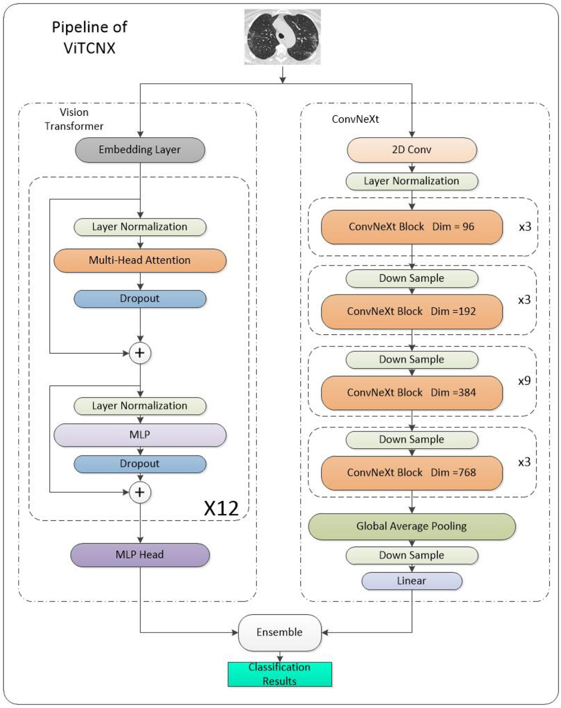
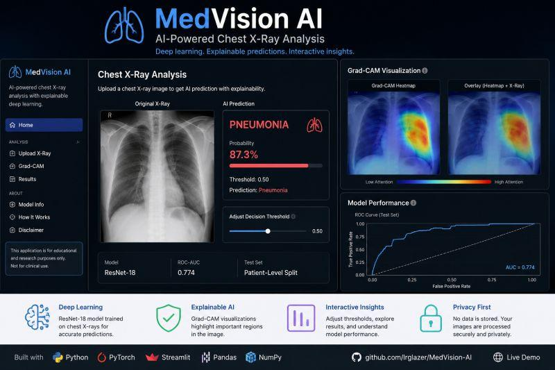

# 🫁 Adaptive CNN–ViT Ensemble for Pneumonia Detection
### Hệ thống Chẩn đoán Viêm Phổi từ ảnh X-quang Ngực kết hợp CNN và Vision Transformer

[](https://www.python.org/)
[](https://pytorch.org/)
[](https://streamlit.io/)
[](https://github.com/huggingface/pytorch-image-models)
[](LICENSE)

> **Khóa luận Tốt nghiệp Đại học - Ngành Công nghệ Thông tin**  
> **Đề tài:** Nghiên cứu phương pháp ensemble cố định giữa CNN và Vision Transformer trong nhận diện viêm phổi từ ảnh X-quang ngực  
> **Mã đề tài:** CNTT-KLCN171  
> **Đơn vị:** Khoa Công nghệ Thông tin - Trường Đại học Công Thương TP.HCM (HUIT)  
> **Giảng viên hướng dẫn:** TS. Phùng Thế Bảo  
> **Sinh viên thực hiện:**  
> 1. **Nguyễn Gia Khang** (Nhóm trưởng - MSSV: 2001230377)  
> 2. **Phan Minh Tâm** (MSSV: 2001230785)  
> 3. **Trịnh Minh Hiếu** (MSSV: 2001230245)  

---

## 📌 1. Giới thiệu Tổng quan

Dự án nghiên cứu và triển khai giải pháp kết hợp mô hình học sâu cố định (**Fixed Ensemble**) và thích ứng (**Adaptive Ensemble**) giữa hai họ kiến trúc tiên tiến:
- **Mạng nơ-ron tích chập (CNN):** `EfficientNet-B4`, `ResNet50` (mạnh về trích xuất đặc trưng cục bộ, viền thâm nhiễm).
- **Vision Transformer (ViT):** `ViT-B/16` (mạnh về tương quan ngữ cảnh toàn cục thông qua cơ chế Self-Attention).

Hệ thống được đánh giá trên tập dữ liệu chuẩn **Chest X-Ray Pneumonia (Kaggle)**, tích hợp phương pháp phân chia theo mã bệnh nhân (**Patient-aware Split**) nhằm chống rò rỉ dữ liệu (*Data Leakage*), bản đồ giải thích **Grad-CAM & ViT Attention**, cùng ứng dụng Web chẩn đoán thời gian thực tích hợp cơ sở dữ liệu y tế an toàn.



---

## 🌟 2. Các Tính năng Cốt lõi

1. **Mô hình hóa Đa kiến trúc (Multi-Architecture Backbones):**
   - Hỗ trợ linh hoạt `EfficientNet-B4`, `ResNet50`, `ViT-B/16` thông qua Model Factory mô-đun hóa.
2. **Chiến lược Ensemble Toàn diện:**
   - **Fixed Soft Voting:** Trung bình hóa xác suất mềm giữa CNN và Vision Transformer.
   - **Fixed Hard Voting:** Biểu quyết đa số nhãn phân loại.
   - **Weighted Soft Voting:** Tự động điều chỉnh trọng số đóng góp theo ROC-AUC trên tập kiểm định Validation.
   - **Tri-Model Ensemble:** Kết hợp sức mạnh của cả 3 mô hình (`EffNet + ViT + ResNet`).
3. **Tiền xử lý Y khoa Chuẩn hóa:**
   - **Bảo toàn tính giải phẫu ngực:** Loại bỏ hoàn toàn `Horizontal Flip` (tránh đảo ngược vị trí bóng tim sang phải).
   - **Patient-aware Split:** Tách tập Validation (837 ảnh) theo mã bệnh nhân (`personID`), đảm bảo không có bệnh nhân nào xuất hiện ở cả tập Train và Val.
   - **Inverse Class Weights:** Khắc phục mất cân bằng dữ liệu 3:1 giữa Viêm phổi và Bình thường, nâng cao độ đặc hiệu (*Specificity*).
4. **Giải thích Quyết định Y khoa (Medical Explainability):**
   - Trích xuất bản đồ nhiệt **Grad-CAM** cho CNN (`conv_head` cho EfficientNet, `layer4` cho ResNet).
   - Trích xuất **Patch-level Attention Grad-CAM** cho Vision Transformer từ 196 patch tokens $14\times 14$.
   - Hiển thị bản đồ nhiệt trực quan theo đúng mô hình được chọn trên giao diện.
5. **Giao diện Web Chẩn đoán & An toàn Dữ liệu:**
   - Web tương tác kéo thả ảnh thời gian thực xây dựng bằng **Streamlit**.
   - Bật ràng buộc khóa ngoại **`PRAGMA foreign_keys = ON;`** trên SQLite.
   - Tuyên bố miễn trừ trách nhiệm y tế (*Medical Disclaimer*) và chính sách xử lý ảnh ẩn danh *in-memory* theo chuẩn HIPAA.
   - Biểu mẫu thu thập nhận xét, đánh giá chuyên môn định tính từ Bác sĩ chẩn đoán hình ảnh.



---

## 📊 3. Kết quả Thực nghiệm (Test Set 624 Ảnh Độc Lập)

### Bảng 1: Kết quả ở Ngưỡng Mặc định 0.50 (kèm 95% Bootstrap CI)

| Mô hình / Phương pháp | Accuracy | Precision | Recall (Sensitivity) | Specificity | F1-Score | ROC-AUC (95% CI) |
| :--- | :---: | :---: | :---: | :---: | :---: | :---: |
| **EfficientNet-B4** | 85.58% | 81.78% | 98.97% | 63.25% | 0.8956 | 0.9654 (0.9513 - 0.9768) |
| **ViT-B/16 (Vision Transformer)** | 84.46% | 80.33% | 99.49% | 59.40% | 0.8889 | **0.9722 (0.9594 - 0.9832)** |
| **ResNet50 (CNN Baseline)** | 84.29% | 80.04% | **99.74%** | 58.55% | 0.8881 | 0.9652 (0.9510 - 0.9770) |
| **Fixed Soft Voting (EffNet + ViT)** | 85.10% | 81.00% | 99.49% | 61.11% | 0.8930 | 0.9700 (0.9573 - 0.9802) |
| **Ensemble (ResNet50 + ViT)** | 84.62% | 80.37% | **99.74%** | 59.40% | 0.8902 | 0.9663 (0.9523 - 0.9780) |
| **Tri-Ensemble (EffNet + ViT + ResNet)** | **85.42%** | **81.21%** | **99.74%** | **61.54%** | **0.8953** | 0.9708 (0.9576 - 0.9820) |

### Bảng 2: Kết quả khi Tối ưu Ngưỡng Youden trên Tập Validation

| Mô hình / Phương pháp | Ngưỡng tối ưu (Val) | Accuracy | Precision | Recall | Specificity | F1-Score | ROC-AUC |
| :--- | :---: | :---: | :---: | :---: | :---: | :---: | :---: |
| **Fixed Soft Voting (EffNet + ViT)** | **0.61** | **87.34%** | **83.59%** | **99.23%** | **67.52%** | **0.9074** | **0.9700** |
| **Ensemble (ResNet50 + ViT)** | 0.61 | 86.38% | 82.38% | 99.49% | 64.53% | 0.9013 | 0.9663 |
| **EfficientNet-B4** | 0.53 | 86.38% | 82.66% | 98.97% | 65.38% | 0.9008 | 0.9654 |
| **ResNet50** | 0.60 | 85.42% | 81.21% | 99.74% | 61.54% | 0.8953 | 0.9652 |
| **ViT-B/16** | 0.29 | 82.69% | 78.54% | 99.49% | 54.70% | 0.8778 | 0.9722 |

### Bảng 3: Đánh giá Độ Ổn định qua 10 Lần chạy Độc lập (10 Random Seeds)

| Mô hình / Phương pháp | Accuracy TB ($\text{Mean} \pm \text{Std}$) | Thấp nhất (Min) | Cao nhất (Max) | F1-Score TB | ROC-AUC TB |
| :--- | :---: | :---: | :---: | :---: | :---: |
| **Tri-Ensemble (EffNet + ViT + ResNet)** | **85.26% ± 1.18%** | 82.53% | **87.02%** | **0.8946** | **0.9657** |
| **EfficientNet-B4** | 84.89% ± 1.10% | 82.85% | 87.02% | 0.8917 | 0.9609 |
| **Fixed Soft Voting (EffNet + ViT)** | 84.71% ± 1.33% | 81.09% | 86.06% | 0.8907 | 0.9659 |
| **Ensemble (ResNet50 + ViT)** | 84.50% ± 1.45% | 80.77% | 86.22% | 0.8898 | 0.9615 |
| **ResNet50** | 84.41% ± 1.06% | 82.05% | 86.06% | 0.8892 | 0.9602 |
| **ViT-B/16** | 84.23% ± 1.46% | 80.45% | 85.74% | 0.8877 | 0.9689 |

---

## 📁 4. Cấu trúc Thư mục Dự án

```text
KhoaLuanTotNghiep/
├── pneumonia-adaptive-ensemble/
│   ├── app.py                            # 🌐 Giao diện Web Streamlit chẩn đoán & Grad-CAM
│   ├── run_all.py                        # 🚀 Pipeline 1-click chạy tự động thực nghiệm
│   ├── requirements.txt                  # 📦 Thư viện phụ thuộc Python
│   ├── README.md                         # 📖 Tài liệu kỹ thuật chi tiết
│   ├── scripts/                          # 🛠️ Các script chạy độc lập
│   │   ├── prepare_dataset.py            # Tải & liên kết tập dữ liệu Kaggle Chest X-Ray
│   │   ├── train_models.py               # Huấn luyện PyTorch GPU (EffNet, ViT, ResNet50)
│   │   ├── evaluate_models.py            # Đánh giá các mô hình & Ensembles (kèm Bootstrap CI)
│   │   ├── run_10_evaluations.py         # Kiểm thử 10 lần chạy & thống kê độ chính xác
│   │   └── generate_heatmaps.py          # Trực quan hóa Grad-CAM & ViT Attention Maps
│   ├── src/                              # 🧠 Mã nguồn lõi Python
│   │   ├── data/
│   │   │   ├── dataset.py                # PyTorch Dataset wrapper
│   │   │   └── split.py                  # Module phân chia theo Patient ID (chống rò rỉ)
│   │   ├── models/
│   │   │   └── factory.py                # Model Factory linh hoạt từ timm
│   │   ├── ensemble/
│   │   │   ├── fixed_ensemble.py         # Soft/Hard Voting & Weighted Voting
│   │   │   └── adaptive_ensemble.py      # Adaptive Ensemble (Confidence/Entropy)
│   │   ├── evaluation/
│   │   │   └── metrics.py                # Tính 7 chỉ số y khoa, Youden Threshold & Bootstrap CI
│   │   ├── explainability/
│   │   │   ├── gradcam.py                # Thuật toán Grad-CAM cho CNN và ViT
│   │   │   └── vit_explain.py            # Giải thích Attention cho Vision Transformer
│   │   └── utils/
│   │       └── database.py               # SQLite cơ sở dữ liệu y tế (PRAGMA foreign_keys = ON)
│   ├── models/                           # 💾 Thư mục chứa trọng số mô hình (.pt)
│   └── results/                          # 📊 Bảng số liệu CSV, Biểu đồ ROC, Boxplot & Grad-CAM
├── INPUT.jpg                             # 🖼️ Minh họa dữ liệu đầu vào
├── MODEL.jpg                             # 🖼️ Sơ đồ kiến trúc mô hình kết hợp
├── PIPELINE.jpg                          # 🖼️ Sơ đồ quy trình thực nghiệm
└── WEBMAU.jpg                            # 🖼️ Ảnh chụp giao diện ứng dụng Web
```

---

## 🚀 5. Hướng dẫn Cài đặt & Chạy Thực nghiệm

### Bước 1: Clone mã nguồn về máy
```bash
git clone https://github.com/minhtamit-dev/KhoaLuanTotNghiep.git
cd KhoaLuanTotNghiep
```

### Bước 2: Thiết lập Môi trường ảo Python (Khuyến nghị Python 3.11 hoặc 3.12)
```bash
# Tạo môi trường ảo bằng venv hoặc uv
python -m venv .venv

# Kích hoạt môi trường ảo:
# Trên Windows PowerShell:
.\.venv\Scripts\Activate.ps1

# Trên Linux / macOS:
source .venv/bin/activate
```

### Bước 3: Cài đặt các thư viện cần thiết
```bash
# Cài đặt PyTorch hỗ trợ GPU CUDA 12.4 (nếu máy có card NVIDIA):
pip install torch torchvision --index-url https://download.pytorch.org/whl/cu124

# Cài đặt toàn bộ dependencies còn lại:
pip install -r pneumonia-adaptive-ensemble/requirements.txt
```

---

## 💻 6. Hướng dẫn Chạy Ứng dụng & Kiểm thử

### 🌐 Khởi chạy Giao diện Web Chẩn đoán (Streamlit Web UI)
```bash
cd pneumonia-adaptive-ensemble
streamlit run app.py
```
👉 Mở trình duyệt truy cập: **`http://localhost:8501`**

### 🚀 Chạy Pipeline Thực nghiệm 1-Click
Tự động chạy toàn bộ quy trình: chuẩn bị dữ liệu $\rightarrow$ huấn luyện $\rightarrow$ đánh giá $\rightarrow$ sinh bản đồ nhiệt:
```bash
cd pneumonia-adaptive-ensemble
python run_all.py
```

### 🛠️ Chạy Kiểm thử Thống kê 10 Lần chạy Độc lập
Chạy lặp 10 lần với 10 random seeds, tính $\text{Mean} \pm \text{Std}$ và vẽ biểu đồ Boxplot:
```bash
cd pneumonia-adaptive-ensemble
python scripts/run_10_evaluations.py
```

### 📈 Chạy Đánh giá Chi tiết Mô hình Đơn lẻ & Ensembles
```bash
cd pneumonia-adaptive-ensemble
python scripts/evaluate_models.py
```

---

## 📜 Giấy phép & Trích dẫn
Đồ án được phát triển phục vụ mục đích nghiên cứu học thuật và giáo dục trong khuôn khổ Khóa luận Tốt nghiệp Đại học tại Trường Đại học Công Thương TP.HCM (HUIT).  
Mã nguồn phát hành theo giấy phép **MIT License**.
